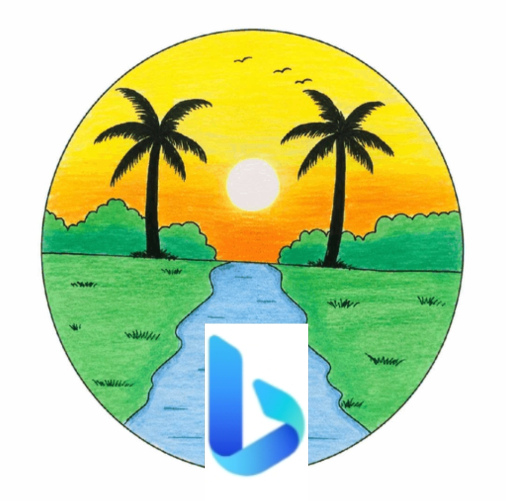

<!DOCTYPE html>
<html lang="ar" dir="rtl">
<head>
<meta charset="UTF-8">
<meta name="viewport" content="width=device-width, initial-scale=1.0">
<title>Alislamiah AI Browser</title>

</head>
<body>

<button class="top-button" onclick="openMenu()">☰</button>
Alislamiah AI

👤

Alislamiah

AI

<h1>Alislamiah-AI Browser</h1>

الذكاء الاصطناعي • البحث • السرعة • الخصوصية

<button class="search-button" onclick="performSearch()">🔍</button>
<input id="searchInput" class="search-input" type="search" placeholder="ابحث في Alislamiah..." onkeydown="handleSearchKey(event)">

الوصول السريع

▶️

YouTube

🤖

AI

🌐

Alislamiah

📱

Explore

⚙️

Settings

📖

Quran

🌤️ Today's weather - 📍 اختر منطقتك - LIVE WEATHER - ⚽ مباريات اليوم - 🌍 أخبار عالمية - 📰 أخبار عربية - 🇸🇦 أخبار السعودية - 🇩🇿 أخبار الجزائر

مادة إعلانية

Alarabiya.net

تابعوا جميع الأخبار العربية والعالمية في منصة العربية.نت
<a class="card-btn" href="#">عرض النتائج</a>

مادة إعلانية

Alislamiah.net

حيث تجدون برامج ومنصات إسلامية على Alislamiah.net
<a class="card-btn" href="#">عرض النتائج</a>

2026 © <strong>Alislamiah AI Browser</strong>

<h2>القائمة</h2><button class="close-menu" onclick="closeMenu()">✕</button>

<button class="menu-item">🏠 الرئيسية</button>
<button class="menu-item">⚙️ الإعدادات</button>
<button class="menu-item">📖 القرآن</button>

</body>
</html>
